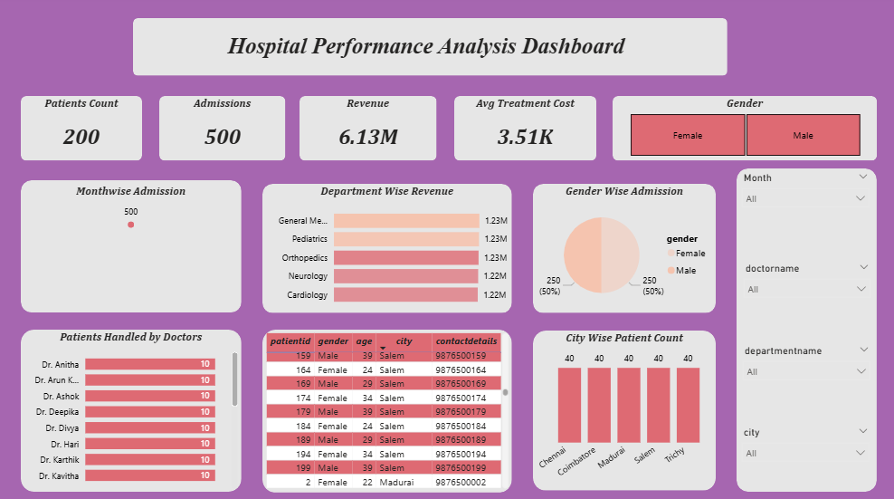

🏥 Hospital Performance Analysis Dashboard | SQL + Power BI

📌 Project Overview

This project focuses on analysing hospital data to evaluate hospital performance, patient admissions, revenue, treatment costs, and operational efficiency through an interactive dashboard developed using Microsoft Power BI.

The dataset was independently created using MySQL by designing database tables and inserting sample records using SQL queries.

The created dataset was then connected to Microsoft Power BI for data analysis and dashboard development.

The main objective of this project is to transform structured hospital data into meaningful insights that help understand patient trends, department-wise revenue, doctor performance, and overall hospital operations.

🎯 Project Objectives

- Create a hospital database using SQL.
- Design database tables and insert sample records.
- Analyse hospital performance and patient admission trends.
- Understand hospital revenue and treatment costs.
- Evaluate department-wise revenue performance.
- Analyse patient admissions based on gender.
- Identify monthly admission trends.
- Understand doctor-wise patient handling.
- Analyse city-wise patient distribution.
- Present meaningful insights through interactive visualisations.

🛠️ Tools & Technologies Used

- MySQL
- SQL
- Microsoft Power BI
- Data Cleaning
- Data Transformation
- Data Analysis
- Data Visualization
- Interactive Dashboard Design
- KPI Cards and Charts

🗄️ Dataset Creation Using SQL

The hospital dataset was independently created using MySQL with sample hospital-related records.

The dataset creation process involved:

- Designing database tables based on hospital-related information.
- Defining appropriate columns and data types.
- Creating tables using CREATE TABLE statements.
- Inserting sample records using INSERT INTO statements.
- Populating tables with hospital-related information.
- Retrieving and validating records using SELECT queries.
- Preparing the dataset for further analysis in Power BI.

🎯 Key Performance Indicators (KPIs)

The dashboard includes the following key metrics:

- Total Patient Count
- Total Admissions
- Hospital Revenue
- Average Treatment Cost

📊 Dashboard Features & Analysis

- **Total Patient Count Analysis:** Understand the overall number of patients handled by the hospital.
- **Total Admissions Analysis:** Track the total number of hospital admissions.
- **Hospital Revenue Analysis:** Evaluate the overall revenue generated by the hospital.
- **Average Treatment Cost Analysis:** Understand the average cost of patient treatments.
- **Department-wise Revenue Analysis:** Compare revenue generated by different hospital departments.
- **Gender-wise Admission Analysis:** Analyse patient admissions based on gender.
- **Month-wise Admission Analysis:** Identify monthly patient admission trends.
- **Patients Handled by Doctors:** Evaluate the number of patients handled by individual doctors.
- **City-wise Patient Count Analysis:** Understand patient distribution across different cities.

🧹 Data Preparation & Transformation

After creating the dataset using SQL, the data was imported into Power BI for further analysis.

The data preparation process included:

- Understanding the dataset structure.
- Checking data quality and consistency.
- Data cleaning
- Preparing data for analysis and visualisation.
- Organising data to create meaningful KPIs and charts.

💡 Key Learnings

Through this project, I gained practical experience in:

- Creating database tables using MySQL.
- Inserting and managing sample records using SQL.
- Retrieving data using SQL queries.
- Connecting structured datasets with Power BI.
- Performing data cleaning and transformation.
- Analysing hospital performance and patient trends.
- Creating KPI cards and interactive visualisations.
- Designing dashboards to present meaningful business insights.

🖥️ Dashboard Preview



📁 Project Structure

```text
Hospital-Performance-Analysis/
│
│
│   └── Hospital_Analytics_Dashboard.pbix
│
│   └── Dashboard.png
│
└── README.md
```

🚀 How to Use This Project

1. Clone or download this repository.
2. Execute the SQL queries to create the database and insert sample records.
3. Open the Power BI dashboard file using Microsoft Power BI Desktop.
4. Explore the dashboard and available visualisations.
5. Interact with the available filters and slicers to analyse hospital performance.

👩‍💻 Author

**Madhumitha**

Aspiring Data Analyst | ECE Graduate

**Skills:**
- Microsoft Excel
- MySQL
- SQL
- Python
- Power BI
- Data Analysis
- Data Visualization

📬 Connect With Me

LinkedIn: https://www.linkedin.com/in/madhumitha-m-a4624232a/

GitHub: https://github.com/MadhumithaM2003

---

⭐ If you find this project useful, feel free to star this repository!
